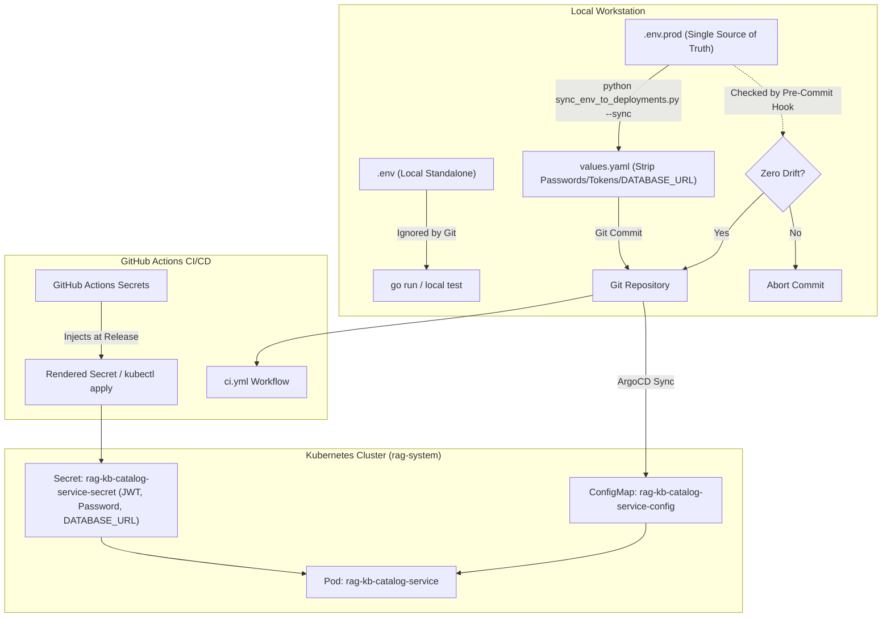

# Secret Management Architecture & CI/CD Injection Guide (`rag-kb-catalog-service`)

This document defines the authoritative secret management strategy, threat mitigation architecture, and automated CI/CD injection patterns for **`rag-kb-catalog-service`**.

---

## 1. Zero-Trust Architectural Principles

In accordance with 12-Factor App methodology and `.ai/security.md`, `rag-kb-catalog-service` strictly decouples non-sensitive configuration parameters from sensitive credentials:

1. **Zero Plaintext Secrets in Git**: Plaintext secrets are strictly prohibited from version control, Helm `values.yaml`, ConfigMaps, and container images.
2. **Dynamic Ingestion Separation**:
   - **Non-Sensitive Operational Config** (`PORT`, `LOG_LEVEL`, `POSTGRES_HOST`, `TEMPORAL_TASK_QUEUE`, etc.) is ingested into Kubernetes via `ConfigMap` (`rag-kb-catalog-service-config`).
   - **Sensitive Cryptographic & Database Credentials** (`JWT_HMAC_SECRET`, `POSTGRES_PASSWORD`, `DATABASE_URL`, `REDIS_PASSWORD`) are injected exclusively via Kubernetes `Secret` (`rag-kb-catalog-service-secret`).
3. **Automated Drift Enforcement**: The repository's synchronization utility (`scripts/sync_env_to_deployments.py`) automatically strips all sensitive keys (`PASSWORD`, `SECRET`, `TOKEN`, `KEY`, and credential URIs like `DATABASE_URL`) before writing to `deployments/helm/rag-kb-catalog-service/values.yaml`.

---

## 2. Sensitive Secret Inventory

| Secret Name | Type / Format | Minimum Constraint | Runtime Usage |
| :--- | :--- | :--- | :--- |
| `JWT_HMAC_SECRET` | Symmetric HMAC Secret (Base64 or UTF-8 string) | $\ge 32$ bytes (256 bits) | **Mandatory for startup**. Verified by HTTP `AuthMiddleware` and gRPC `AuthInterceptor` on every request. Service fails immediately with `ErrJWTSecretTooShort` if $< 32$ bytes. |
| `POSTGRES_PASSWORD` | Alphanumeric Password String | $\ge 16$ characters | Authenticates `pgxpool` against PostgreSQL 16 / PgBouncer when using modular parameters (`POSTGRES_HOST`, etc.). |
| `DATABASE_URL` | Complete PostgreSQL Connection URI with credentials | Valid `postgres://` or `postgresql://` URI | **Alternative database connection secret** (e.g., Neon Serverless Postgres, AWS Aurora, Cloud SQL). Injected into Kubernetes Secret. Takes precedence over modular host/user parameters when set. |
| `REDIS_PASSWORD` | Alphanumeric Password String | Optional in dev, required in prod | Authenticates the distributed cache client against Redis 7.2 Cluster nodes (`AUTH`). |

---

## 3. CI/CD Secret Injection via GitHub Actions

GitHub Actions operates as the primary automated validation and secret injection engine during CI and release deployment.

### A. Configuring GitHub Actions Secrets

Navigate to **GitHub Repository $\rightarrow$ Settings $\rightarrow$ Secrets and variables $\rightarrow$ Actions** and configure the following secrets under **Repository secrets** or targeted **Environment secrets** (`production`, `staging`):

```bash
# Core Application Credentials
JWT_HMAC_SECRET="<generate with: openssl rand -base64 32>"
POSTGRES_PASSWORD="<production-database-password>"
REDIS_PASSWORD="<production-redis-cluster-password>"

# Optional Alternative: Full Database Connection String (e.g. Neon Serverless Postgres)
DATABASE_URL="postgres://<user>:<password>@<ep-neon-host>.neon.tech/neondb?sslmode=require"

# Optional: Direct Cluster Access (if deploying directly from GitHub Actions instead of ArgoCD)
KUBECONFIG="<base64-encoded-kubeconfig-file>"
```

### B. CI Validation Workflow (`.github/workflows/ci.yml`)

During every CI pull request and commit build, GitHub Actions performs automated secret injection tests:

1. **Secret Masking**: Injected environment variables are registered via `echo "::add-mask::$SECRET"` to ensure credentials never appear in console runner output.
2. **Template Synthesis**: Renders `deployments/helm/rag-kb-catalog-service` with injected secrets to verify that the template enforces length validation ($\ge 32$ bytes) and renders a valid `kind: Secret` manifest containing `POSTGRES_PASSWORD`, `REDIS_PASSWORD`, `JWT_HMAC_SECRET`, and optional `DATABASE_URL`.
3. **Artifact Cleanup**: Rendered manifests containing secrets are scrubbed immediately after verification.

### C. Automated CD Release Injection (`cd-secret-injection-and-deployment`)

When commits merge to `main` or `rag-kb-catalog-service`:

```yaml
# GitHub Actions Step: Inject Secrets into Kubernetes Cluster
- name: Deploy Injected Secret to Kubernetes Cluster
  env:
    KUBECONFIG_DATA: ${{ secrets.KUBECONFIG }}
    JWT_HMAC_SECRET: ${{ secrets.JWT_HMAC_SECRET }}
    POSTGRES_PASSWORD: ${{ secrets.POSTGRES_PASSWORD }}
    REDIS_PASSWORD: ${{ secrets.REDIS_PASSWORD }}
    DATABASE_URL: ${{ secrets.DATABASE_URL }}
  run: |
    if [ -n "$KUBECONFIG_DATA" ] && [ -n "$JWT_HMAC_SECRET" ]; then
      mkdir -p ~/.kube
      echo "$KUBECONFIG_DATA" | base64 -d > ~/.kube/config
      kubectl create namespace rag-system --dry-run=client -o yaml | kubectl apply -f -
      
      EXTRA_LITERALS=""
      if [ -n "$DATABASE_URL" ]; then
        EXTRA_LITERALS="--from-literal=DATABASE_URL=$DATABASE_URL"
      fi

      kubectl create secret generic rag-kb-catalog-service-secret \
        --namespace rag-system \
        --from-literal=JWT_HMAC_SECRET="$JWT_HMAC_SECRET" \
        --from-literal=POSTGRES_PASSWORD="$POSTGRES_PASSWORD" \
        --from-literal=REDIS_PASSWORD="$REDIS_PASSWORD" \
        $EXTRA_LITERALS \
        --dry-run=client -o yaml | kubectl apply -f -
      rm -rf ~/.kube
    fi
```

---

## 4. GitOps Secret Management Patterns (ArgoCD & Kubernetes)

Because GitOps engines like ArgoCD synchronize directly from Git, plaintext secrets cannot live in the Git repository. Use one of the three industry-standard patterns below:

### Pattern 1: External Secrets Operator (ESO) + Cloud Secret Manager (Recommended)

In this pattern, ArgoCD manages non-sensitive templates from Git, while the **External Secrets Operator** reconciles credentials from AWS Secrets Manager, Google Cloud Secret Manager, Azure Key Vault, or Neon Console directly into the cluster `Secret`.

```yaml
apiVersion: external-secrets.io/v1beta1
kind: SecretStore
metadata:
  name: cloud-secret-store
  namespace: rag-system
spec:
  provider:
    aws:
      service: SecretsManager
      region: us-east-1
      auth:
        jwt:
          serviceAccountRef:
            name: rag-kb-catalog-service
---
apiVersion: external-secrets.io/v1beta1
kind: ExternalSecret
metadata:
  name: rag-kb-catalog-service-external-secret
  namespace: rag-system
spec:
  refreshInterval: 1h
  secretStoreRef:
    name: cloud-secret-store
    kind: SecretStore
  target:
    name: rag-kb-catalog-service-secret
    creationPolicy: Owner
  data:
    - secretKey: JWT_HMAC_SECRET
      remoteRef:
        key: production/rag-kb-catalog-service
        property: jwt_hmac_secret
    - secretKey: POSTGRES_PASSWORD
      remoteRef:
        key: production/rag-kb-catalog-service
        property: postgres_password
    - secretKey: DATABASE_URL
      remoteRef:
        key: production/rag-kb-catalog-service
        property: database_url
    - secretKey: REDIS_PASSWORD
      remoteRef:
        key: production/rag-kb-catalog-service
        property: redis_password
```

### Pattern 2: HashiCorp Vault Agent / CSI Driver

When HashiCorp Vault is the enterprise source of truth, mount credentials into container memory via the Secrets Store CSI driver (`secrets-store.csi.k8s.io`):

```yaml
spec:
  template:
    spec:
      volumes:
        - name: secrets-store-inline
          csi:
            driver: secrets-store.csi.k8s.io
            readOnly: true
            volumeAttributes:
              secretProviderClass: "vault-rag-catalog-service"
```

### Pattern 3: Bitnami Sealed Secrets

If all manifests must reside entirely in Git without external cloud dependencies:
1. Encrypt secrets locally using `kubeseal` and the cluster public key:
   ```bash
   kubectl create secret generic rag-kb-catalog-service-secret \
     --namespace rag-system \
     --from-literal=JWT_HMAC_SECRET="$JWT_HMAC_SECRET" \
     --from-literal=POSTGRES_PASSWORD="$POSTGRES_PASSWORD" \
     --from-literal=DATABASE_URL="$DATABASE_URL" \
     --from-literal=REDIS_PASSWORD="$REDIS_PASSWORD" \
     --dry-run=client -o yaml | kubeseal --format yaml > deployments/helm/rag-kb-catalog-service/templates/sealed-secret.yaml
   ```
2. Commit `sealed-secret.yaml` safely to Git. Only the cluster's Sealed Secrets controller possesses the private key to decrypt it.

---

## 5. Local Development vs. Production Lifecycle



---

## 6. Zero-Downtime Secret Rotation Runbook

### A. Rotating `JWT_HMAC_SECRET`
1. Update `JWT_HMAC_SECRET` in GitHub Secrets or Cloud Secret Store.
2. Trigger secret injection:
   - For GitHub Actions: Run the `cd-secret-injection-and-deployment` workflow.
   - For ESO: Force immediate reconciliation (`kubectl annotate externalsecret rag-kb-catalog-service-external-secret force-sync=$(date +%s) --overwrite -n rag-system`).
3. Rolling restart:
   ```bash
   kubectl rollout restart deployment/rag-kb-catalog-service -n rag-system
   ```

### B. Rotating `POSTGRES_PASSWORD` or `DATABASE_URL`
1. Alter password on PostgreSQL / PgBouncer instance (or regenerate in Neon dashboard).
2. Update `POSTGRES_PASSWORD` and/or `DATABASE_URL` in GitHub Actions Secrets or Cloud Secret Store.
3. Apply updated Secret to Kubernetes.
4. Perform rolling restart of `deployment/rag-kb-catalog-service`:
   ```bash
   kubectl rollout restart deployment/rag-kb-catalog-service -n rag-system
   ```
