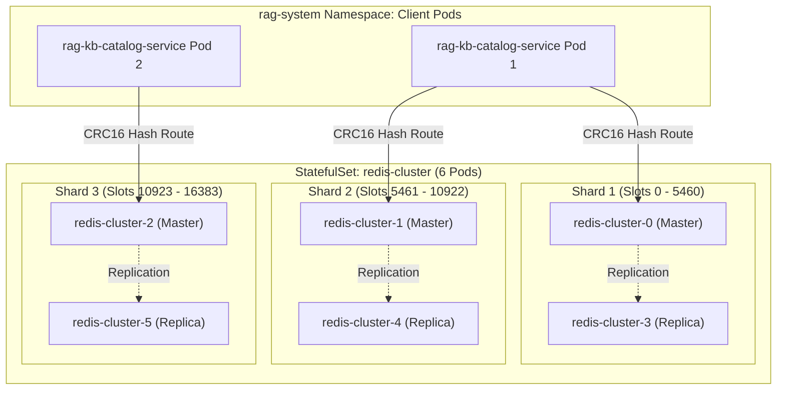

# Self-Hosted Redis Cluster Architecture & Deployment Guide (`rag-kb-catalog-service`)

This document defines the deployment architecture, configuration parameters, and operational runbook for the self-hosted **Bitnami Redis 7.2 Cluster** backing `rag-kb-catalog-service`.

---

## 1. Architectural Motivation & Performance SLIs

In accordance with [`.ai/project-overview.md`](../.ai/project-overview.md) and [`ADR-003`](../.ai/architecture.md), Redis operates as the **authoritative high-speed read plane** for the catalog microservice:

1. **Sub-Millisecond Read Latency ($P99 \le 5\text{ms}$ at 3,000 RPS)**:
   - Co-locating the Redis Cluster inside the Kubernetes cluster (`rag-system` namespace) yields round-trip network latencies of **$0.2\text{ms} - 0.6\text{ms}$**, completely bypassing public internet hops and cloud NAT gateway overhead.
2. **CRC16 Hash Slot Co-Location (`{tenant_id}`)**:
   - Keys follow the versioned contract `kb:{tenant_id}:{id}:v{version}` and `kb:{tenant_id}:{id}:latest_version`.
   - Redis Cluster uses CRC16 hash tags (`{tenant_id}`) to ensure all catalog records for a given tenant reside on the exact same master shard, eliminating cross-slot redirects during batch operations.
3. **Zero Pay-Per-Command Fees**:
   - Unlike serverless providers (e.g. Upstash, which would cost thousands of dollars per month at 3,000 RPS), in-cluster Redis has a fixed, negligible resource footprint on existing worker nodes.

---

## 2. Cluster Topology & Node Specifications



- **Release Name**: `redis-cluster`
- **Namespace**: `rag-system` (dedicated to the catalog domain)
- **Pods**: 6 (3 Master nodes + 3 Replica nodes across availability zones)
- **Headless DNS Service**: `redis-cluster-headless.rag-system.svc.cluster.local:6379`
- **Resource Sizing (per pod)**:
  - CPU: Requests `100m`, Limits `500m`
  - RAM: Requests `256Mi`, Limits `1Gi`
- **Persistence**: Append-Only File (AOF) + RDB snapshots (5Gi PVC)
- **Secret Integration**: Directly reads `REDIS_PASSWORD` from the existing `rag-kb-catalog-service-secret`.

---

## 3. Deployment Methods

### Option A: Automated CLI Script (Recommended for Manual/CI Installs)

Bash (Linux / macOS):
```bash
./scripts/deploy_redis_cluster.sh
```

PowerShell (Windows):
```powershell
.\scripts\deploy_redis_cluster.ps1
```

The script automatically:
1. Adds the Bitnami Helm repository.
2. Applies `deployments/helm/redis-cluster/values.yaml`.
3. Waits for all 6 StatefulSet pods to achieve `Ready` state.
4. Validates that all 16,384 cluster slots are assigned and healthy.

---

### Option B: Declarative ArgoCD GitOps Deployment

For production GitOps pipelines, apply the declarative ArgoCD application:

```bash
kubectl apply -f deployments/argocd/redis-cluster-application.yaml
```

ArgoCD will automatically pull the official Bitnami `redis-cluster` chart (`v11.1.0`), inject the cluster values, and maintain auto-healing and pruning.

---

### Option C: Local Development with Docker Compose

For local development and unit/integration testing on your workstation:

```bash
# Start local Redis 7.2 container
docker compose -f deployments/docker/docker-compose.redis.yml up -d

# Verify local Redis connection
docker exec -it rag-catalog-redis-local redis-cli -a change-me-redis-password ping
# Output: PONG

# Stop local container
docker compose -f deployments/docker/docker-compose.redis.yml down
```

---

## 4. Connecting `rag-kb-catalog-service` to Redis Cluster

### 1. In `.env.prod`:
Ensure your single source of truth references the in-cluster headless DNS endpoints:

```env
# Redis 7.2 Cluster Distributed Versioned Cache (ADR-003)
REDIS_CLUSTER_ADDRS="redis-cluster-0.redis-cluster-headless.rag-system.svc.cluster.local:6379,redis-cluster-1.redis-cluster-headless.rag-system.svc.cluster.local:6379,redis-cluster-2.redis-cluster-headless.rag-system.svc.cluster.local:6379"
REDIS_PASSWORD="change-me-to-a-secure-redis-password"
```

### 2. Synchronize to Helm Values:
```bash
python scripts/sync_env_to_deployments.py --sync
```

### 3. Update REDIS_PASSWORD in Shared Secret:
Update `REDIS_PASSWORD` through the shared Secret's owner (e.g. CI/CD secret injection or strategic merge patch) to preserve existing `JWT_HMAC_SECRET`, `POSTGRES_PASSWORD`, and `DATABASE_URL` keys in `rag-kb-catalog-service-secret`:
```bash
kubectl patch secret rag-kb-catalog-service-secret \
  --namespace rag-system \
  --type merge \
  -p '{"stringData":{"REDIS_PASSWORD":"change-me-to-a-secure-redis-password"}}'
```

---

## 5. Day-2 Operations & Monitoring

### A. Health & Shard Status Verification
```bash
# Query cluster status
kubectl exec -it redis-cluster-0 -n rag-system -- redis-cli -c -a $(kubectl get secret rag-kb-catalog-service-secret -n rag-system -o jsonpath='{.data.REDIS_PASSWORD}' | base64 -d) cluster info

# List master and replica node mappings
kubectl exec -it redis-cluster-0 -n rag-system -- redis-cli -c -a $(kubectl get secret rag-kb-catalog-service-secret -n rag-system -o jsonpath='{.data.REDIS_PASSWORD}' | base64 -d) cluster nodes
```

Expected output:
```text
cluster_state:ok
cluster_slots_assigned:16384
cluster_slots_ok:16384
cluster_known_nodes:6
cluster_size:3
```

### B. Live Real-Time Latency Check
```bash
kubectl exec -it redis-cluster-0 -n rag-system -- redis-cli -a <password> --latency
# Typical output: min: 0, max: 1, avg: 0.18 (802 samples) -> Sub-millisecond!
```

### C. Prometheus Scrape Configuration
The chart exposes Prometheus metrics natively on port `9121` (`/metrics`). Prometheus Server or Prometheus Operator will automatically scrape each Redis pod using standard pod annotations:
```yaml
annotations:
  prometheus.io/scrape: "true"
  prometheus.io/port: "9121"
  prometheus.io/path: "/metrics"
```
Key Prometheus metrics to monitor:
- `redis_connected_clients`: Active client connections from catalog service pods.
- `redis_memory_used_bytes` / `redis_memory_max_bytes`: Ensure memory utilization stays $< 75\%$.
- `redis_commands_duration_seconds_total`: P99 command execution latency.

